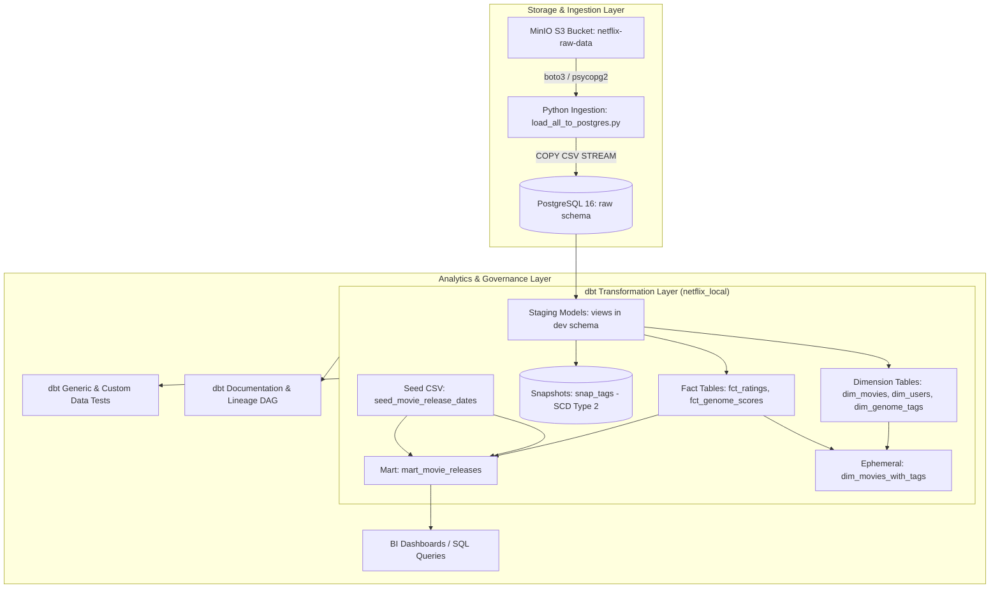

# 🎬 Netflix & MovieLens Modern Data Platform (ELT with dbt & PostgreSQL)

An end-to-end, production-grade Modern Data Stack (MDS) pipeline built to ingest, model, test, and analyze over 20+ million movie ratings, metadata, tags, and genome relevance scores.

The platform leverages **MinIO (S3-compatible Object Storage)**, **PostgreSQL 16**, and **dbt Core (Data Build Tool)** using dimensional modeling (Kimball methodology), Type-2 Slowly Changing Dimensions (SCD Type 2 snapshots), incremental fact tables, custom macros, and automated testing suites.

---

## 📑 Table of Contents
1. [Architecture Overview](#-architecture-overview)
2. [Technology Stack](#-technology-stack)
3. [Project Directory Structure](#-project-directory-structure)
4. [Infrastructure Services](#-infrastructure-services)
5. [Data Pipeline & Modeling Layers](#-data-pipeline--modeling-layers)
   - [Raw Schema (PostgreSQL Ingestion)](#1-raw-schema-ingestion)
   - [Staging Layer (Bronze Views)](#2-staging-layer-bronze)
   - [Dimensional & Fact Layer (Silver Tables)](#3-core-dimensions--facts-silver)
   - [Analytics Marts (Gold Layer)](#4-analytics-marts-gold)
   - [Snapshots (SCD Type 2)](#5-snapshots-scd-type-2)
   - [Seeds (Reference Data)](#6-seeds-reference-data)
6. [Data Quality & Testing](#-data-quality--testing)
7. [Step-by-Step Setup Guide](#-step-by-step-setup-guide)
8. [Common Commands Cheat Sheet](#-common-commands-cheat-sheet)
9. [Troubleshooting & Key Considerations](#-troubleshooting--key-considerations)

---

## 🏛 Architecture Overview



---

## 💻 Technology Stack

| Component | Tool / Technology | Version | Purpose |
| :--- | :--- | :--- | :--- |
| **Database** | PostgreSQL | `16-alpine` | Primary analytics warehouse & storage |
| **Object Storage** | MinIO | `latest` | S3-compatible raw data lake storage |
| **DB Admin UI** | pgAdmin 4 | `latest` | Web-based relational database administration |
| **Transformation** | dbt Core | `1.12.5` | Modular SQL transformations, testing, and documentation |
| **dbt Adapter** | `dbt-postgres` | `1.11.0` | PostgreSQL database connection adapter |
| **dbt Package** | `dbt-labs/dbt_utils` | `1.3.0` | Surrogate key generation and SQL helper macros |
| **Ingestion Script** | Python / Boto3 / Psycopg2 | `Python 3.12+` | High-throughput streaming data loader from MinIO into Postgres |
| **Containerization**| Docker Compose | `v2+` | Multi-container orchestration (PostgreSQL, MinIO, pgAdmin) |

---

## 📂 Project Directory Structure

```text
netflix_data_analysis/
├── docker-compose.yml              # Multi-container Docker configuration
├── load_all_to_postgres.py         # Python raw data loader (MinIO -> Postgres)
├── README.md                       # Comprehensive project documentation
├── data/                           # Local mount directory for container storage
├── netflix_local/                  # Root of the dbt project
│   ├── dbt_project.yml             # dbt configuration, paths, and model materializations
│   ├── packages.yml                # Package dependencies (e.g. dbt_utils)
│   ├── package-lock.yml            # Locked package versions
│   ├── README.md                   # dbt-specific reference guide
│   ├── analyses/                   # Ad-hoc analytical queries
│   ├── macros/
│   │   └── no_nulls_in_columns.sql # Custom generic macro scanning columns for NULLs
│   ├── models/
│   │   ├── sources.yml             # Source definitions for PostgreSQL raw.* tables
│   │   ├── schema.yml              # Documentation, column descriptions, and tests
│   │   ├── staging/                # Bronze views (raw data cleaning & renaming)
│   │   │   ├── stg_movies.sql
│   │   │   ├── stg_ratings.sql
│   │   │   ├── stg_tags.sql
│   │   │   ├── stg_links.sql
│   │   │   ├── stg_genome_tags.sql
│   │   │   └── stg_genome_score.sql
│   │   ├── dim/                    # Silver dimension tables
│   │   │   ├── dim_movies.sql
│   │   │   ├── dim_users.sql
│   │   │   ├── dim_genome_tags.sql
│   │   │   └── dim_movies_with_tags.sql (ephemeral)
│   │   ├── fct/                    # Silver fact tables
│   │   │   ├── fct_ratings.sql     # Incremental fact table (~20M rows)
│   │   │   └── fct_genome_scores.sql
│   │   └── mart/                   # Gold business marts
│   │       └── mart_movie_releases.sql
│   ├── seeds/
│   │   └── seed_movie_release_dates.csv # Reference CSV for movie release dates
│   ├── snapshots/
│   │   └── snap_tags.sql           # Type-2 Slowly Changing Dimension snapshot
│   └── tests/                      # Custom singular tests
```

---

## 🐳 Infrastructure Services

All services are orchestrated via [`docker-compose.yml`](file:///d:/netflix_data_analysis/docker-compose.yml):

| Service | Container Name | Port | Internal / External Credentials |
| :--- | :--- | :--- | :--- |
| **PostgreSQL** | `netflix_postgres` | `5432` | DB: `movielens` \| User: `postgres` \| Password: `postgrespassword` |
| **pgAdmin 4** | `netflix_pgadmin` | `5050` | Email: `admin@admin.com` \| Password: `adminpassword` |
| **MinIO API** | `netflix_minio` | `9000` | User: `minioadmin` \| Password: `minioadmin` |
| **MinIO UI** | `netflix_minio` | `9090` | Web Console: [http://localhost:9090](http://localhost:9090) |

To launch services:
```bash
docker compose up -d
```

---

## 🔄 Data Pipeline & Modeling Layers

### 1. Raw Schema (Ingestion)
The script [`load_all_to_postgres.py`](file:///d:/netflix_data_analysis/load_all_to_postgres.py) reads the MovieLens datasets stored in MinIO (`netflix-raw-data` bucket) and executes high-speed streaming `COPY` commands into the PostgreSQL `raw` schema:
* `raw.raw_movies` (`movie_id`, `title`, `genres`)
* `raw.raw_ratings` (`user_id`, `movie_id`, `rating`, `timestamp`) - Over 20 million rows
* `raw.raw_tags` (`user_id`, `movie_id`, `tag`, `timestamp`)
* `raw.raw_links` (`movie_id`, `imdb_id`, `tmdb_id`)
* `raw.raw_genome_tags` (`tag_id`, `tag`)
* `raw.raw_genome_scores` (`movie_id`, `tag_id`, `relevance`) - Over 11 million rows

### 2. Staging Layer (Bronze)
Materialized as **views** in schema `dev`. Performs light transformations such as field aliasing, casting timestamps with `TO_TIMESTAMP(timestamp)`, and standardizing naming:
* `stg_movies`: Standardized movie identifiers and raw genres.
* `stg_ratings`: Standardized rating entries with timestamp conversion.
* `stg_tags`: Cleaned user-applied tags with timestamp conversion.
* `stg_links`: External IDs (IMDb, TMDb) for downstream integrations.
* `stg_genome_tags`: Genome tag IDs and labels.
* `stg_genome_score`: Raw relevance calculations.

### 3. Core Dimensions & Facts (Silver)
Materialized as **physical tables** (configured in `dbt_project.yml`):
* `dim_movies`: Formats movie titles using `INITCAP(TRIM(title))` and converts pipe-separated genres into PostgreSQL arrays (`STRING_TO_ARRAY(genres, '|')`).
* `dim_users`: Deduped union of unique users identified in both ratings and tags.
* `dim_genome_tags`: Cleansed, distinct tag labels.
* `dim_movies_with_tags` (*Ephemeral*): Enriches movie entities by joining genome scores and tag labels without persisting intermediate storage.
* `fct_ratings` (*Incremental*): Materialized with `strategy = 'incremental'` and `on_schema_change = 'fail'`. Filters out NULL ratings and handles 20M+ rows efficiently by appending only new records:
  ```sql
  
    AND rating_timestamp > (SELECT MAX(rating_timestamp) FROM {{ this }})
  
  ```
* `fct_genome_scores`: Contains rounded relevance scores (`ROUND(relevance::numeric, 4)`) where relevance score > 0.

### 4. Analytics Marts (Gold)
* `mart_movie_releases`: Merges `fct_ratings` with the reference seed `seed_movie_release_dates`, creating a business-ready table with enriched dimensions and a flag (`release_info_available`) indicating whether release information is available.

### 5. Snapshots (SCD Type 2)
Located in [`snapshots/snap_tags.sql`](file:///d:/netflix_data_analysis/netflix_local/snapshots/snap_tags.sql):
* Implements **Slowly Changing Dimensions (Type 2)** for user-submitted movie tags.
* Generates a deterministic surrogate key using `dbt_utils.generate_surrogate_key(['user_id','movie_id','tag'])`.
* Tracks changes over time using `strategy='timestamp'`, targeting `tag_timestamp` and preserving historical records in the `snapshots` schema.

### 6. Seeds (Reference Data)
* [`seeds/seed_movie_release_dates.csv`](file:///d:/netflix_data_analysis/netflix_local/seeds/seed_movie_release_dates.csv): Reference seed mapping movie IDs to historical release dates.

---

## 🧪 Data Quality & Testing

Data integrity is enforced using dbt tests defined in [`models/schema.yml`](file:///d:/netflix_data_analysis/netflix_local/models/schema.yml):

1. **Not-Null Constraints**:
   - Validated on primary and foreign keys (`movie_id`, `user_id`, `tag_id`, `rating`, `relevance_score`).
2. **Referential Integrity (`relationships`)**:
   - Enforces foreign key relationships between `fct_ratings.movie_id` and `dim_movies.movie_id`.
   - Uses modern dbt syntax with nested `arguments:` to maintain compatibility with dbt 1.8+:
     ```yaml
     - relationships:
         arguments:
           to: ref('dim_movies')
           field: movie_id
     ```
3. **Custom Generic Macro**:
   - [`macros/no_nulls_in_columns.sql`](file:///d:/netflix_data_analysis/netflix_local/macros/no_nulls_in_columns.sql): Dynamic macro allowing automated NULL scanning across all columns in any relation.

---

## 🚀 Step-by-Step Setup Guide

### Prerequisites
- [Docker & Docker Compose](https://www.docker.com/)
- [Python 3.10+](https://www.python.org/)
- PowerShell / Bash

### 1. Clone & Navigate to Project
```powershell
cd d:\netflix_data_analysis
```

### 2. Start Infrastructure
```powershell
docker compose up -d
```
Verify containers are running:
```powershell
docker compose ps
```

### 3. Load Raw Data into PostgreSQL
Activate your Python virtual environment and run the ingestion script:
```powershell
.\venv\Scripts\activate
python load_all_to_postgres.py
```

### 4. Configure dbt Profile
Ensure your `~/.dbt/profiles.yml` (located at `C:\Users\<username>\.dbt\profiles.yml`) contains the following configuration:
```yaml
netflix_local:
  target: dev
  outputs:
    dev:
      type: postgres
      host: localhost
      port: 5432
      user: postgres
      password: postgrespassword
      dbname: movielens
      schema: dev
      threads: 4
```

### 5. Install dbt Dependencies
Navigate to the dbt project folder and install required packages (such as `dbt_utils`):
```powershell
cd .\netflix_local\
dbt deps
```

### 6. Load Seeds
Load seed data into PostgreSQL:
```powershell
dbt seed
```

### 7. Run Models & Snapshots
Execute models and snapshot tracking:
```powershell
# Run all staging, dimensional, fact, and mart models
dbt run

# Run SCD Type-2 snapshots
dbt snapshot
```

### 8. Run Test Suite
Validate data quality and integrity:
```powershell
dbt test
```

### 9. Generate & View Documentation
Compile project documentation and interactive DAG lineage graph:
```powershell
dbt docs generate
dbt docs serve --port 8080
```
Open [http://localhost:8080](http://localhost:8080) in your browser.

---

## 📌 Common Commands Cheat Sheet

| Command | Description |
| :--- | :--- |
| `dbt deps` | Downloads and installs package dependencies from `packages.yml` |
| `dbt seed` | Loads CSV files from `/seeds` into target database tables |
| `dbt run` | Executes all SQL model transformations |
| `dbt run --select staging` | Executes only staging layer models |
| `dbt run --select dim+` | Executes dimension models and all downstream dependencies |
| `dbt snapshot` | Executes SCD Type 2 snapshot operations |
| `dbt test` | Executes all generic and singular tests |
| `dbt test --select fct_ratings` | Tests only the `fct_ratings` model |
| `dbt docs generate` | Generates `manifest.json` and `catalog.json` documentation |
| `dbt docs serve` | Serves local interactive documentation at `http://localhost:8080` |

---

## 🔧 Troubleshooting & Key Considerations

* **PostgreSQL vs Snowflake SQL Dialects**:
  * PostgreSQL does not use `TIMESTAMP_NTZ`. Use `TIMESTAMP` or `TIMESTAMPTZ` with `TO_TIMESTAMP()`.
  * Ensure snapshot `unique_key` references a single column string (e.g. `'row_key'`) rather than an array.
* **Large Datasets & Incremental Materialization**:
  * `fct_ratings` handles over 20M+ rows. Always use `dbt run --select fct_ratings` with incremental filters to avoid full table scans.
* **Generic Test Deprecations in dbt 1.8+**:
  * When using generic tests like `relationships`, always nest `to` and `field` under `arguments:` to avoid deprecation warnings.
* **Missing Package Dependencies**:
  * If encountering `'dbt_utils' is undefined`, verify that `packages.yml` exists and run `dbt deps`.
